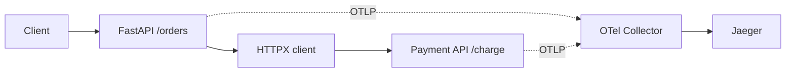

# Production runbook: API → downstream HTTP API latency

**Scope:** Client → FastAPI `/orders` → HTTPX → Payment API `/charge`. This runbook intentionally excludes databases, Kafka, and Kubernetes. The goal is to determine **where** time is spent, **why** it is spent there, and **whether a mitigation helped**.

## 1. Start with the user-visible symptom

Record incident start time, affected endpoint, p50/p95/p99, requests per second, HTTP status mix, timeout/error rates, and in-flight requests. Compare a normal baseline and an incident window. Separate user-visible errors from client-side exceptions; `httpx.PoolTimeout` is not an HTTP 503 response.

## 2. Trace the request path

Open a slow Jaeger trace. Identify the FastAPI server span, outgoing HTTPX client span (if present), and downstream FastAPI server span. Confirm they share a trace ID and have the expected parent-child relationships. **Nested durations overlap: never add them together.** Check for clock skew if cross-host span bars seem inconsistent.

**Caution:** An HTTPX client span is not a phase-by-phase profiler. A gap between HTTP client and downstream server duration may include connection acquisition, DNS, TCP/TLS, transport latency, scheduling, response transfer, and instrumentation overhead. You need additional measurements to attribute it.

## 3. Diagnostic matrix

| Symptom | Check | Evidence | Mitigation | Tradeoff / trap |
|---|---|---|---|---|
| Caller slow, downstream fast | Event-loop lag, CPU, HTTP client span, pool | Caller duration not explained by downstream server span | Profile caller; isolate pool/network/serialization | Span gap alone is not a root cause |
| Downstream server slow | `/charge` server spans, downstream concurrency, CPU | Downstream p95/p99 rises | Fix downstream; use deadlines/backpressure | Caller timeout changes don't speed downstream |
| HTTPX `PoolTimeout` | `max_connections`, pool timeout, concurrency | Exception while acquiring connection | Bound concurrency, tune pool, load shed | Not an HTTP response |
| `ConnectTimeout` | DNS/TCP/TLS/proxy, connection reuse | Failure in connection establishment | Fix routing/DNS/TLS; reuse clients | Increasing read timeout won't help |
| `ReadTimeout` | Response timing, downstream behavior | Read stalls after connection | Set read/deadline budget; inspect dependency | Remote side may already have acted |
| HTTP 429/503 | Status rate, `Retry-After`, capacity | Actual HTTP response from downstream | Backpressure; bounded safe retries | Retry storms amplify overload |
| p99 spike / p50 stable | Histograms, outlier traces, queueing | Tail grows without median shift | Identify tail cause, tune concurrency | Averages conceal tail failures |
| Event-loop blocked | Lag, CPU profiling, sync calls in `async def` | Caller work delays unrelated requests | Use nonblocking I/O, offload CPU work | `async def` does not make blocking calls async |
| Retry storm | Attempts/original request, downstream QPS | Amplification factor rises | Retry budget, jitter, circuit breaker | Payment POST retries need idempotency |
| Large response overhead | Payload size, JSON decoding/validation | Caller work after HTTP client span | Reduce payload, optimize processing | Don't confuse local work with network delay |

## 4. Timeout taxonomy

- **Pool timeout:** Waiting for a free connection in the local HTTPX pool. No outbound request may have been sent.
- **Connect timeout:** DNS/TCP/TLS connection establishment exceeded its budget (exact phase requires deeper evidence).
- **Read timeout:** Waiting for response data exceeded the read timeout; does not prove the remote operation failed.
- **Write timeout:** Sending request data stalled.
- **HTTP 429/503:** Real status responses; different from local HTTPX exceptions.

Use an **end-to-end deadline** across phases and retries. Individual phase timeouts are not automatically an end-to-end deadline.

## 5. Resilience decisions

- Reuse one long-lived `httpx.AsyncClient` per application lifecycle where appropriate; don't create one per request.
- Bound in-flight requests and apply backpressure. Size connection pools using measured concurrency and downstream limits.
- Retry only when safe and within a retry budget; use exponential backoff with jitter. Respect `Retry-After` when applicable.
- For payment-like POST operations, use idempotency keys and reconciliation; a timeout can mean **unknown outcome**, not failure.
- Consider circuit breakers and bulkheads when downstream failures threaten the caller.
- Telemetry should not block customer requests: use bounded async batch exporting; monitor dropped spans and Collector health.

## 6. Incident response sequence

1. **Observe:** Capture p95/p99, QPS, errors, timeout class, saturation and baseline.
2. **Locate:** Compare caller server, HTTP client, downstream server spans in the same trace.
3. **Classify:** Pool, connect, read/write, downstream HTTP error, local CPU/queueing or response processing.
4. **Prove:** Collect targeted phase timing, event-loop metrics, dependency metrics or CPU profile; reproduce if safe.
5. **Mitigate:** Apply one reversible, evidence-backed change. Don't increase replicas or timeouts blindly.
6. **Verify:** Compare p99, errors, throughput, retry amplification and resource pressure before/after.
7. **Document:** Record timeline, contributing factors, root-cause confidence, corrective actions and owner.

## 7. Our local lab: verified vs hypothetical

**Observed in the user's local lab:** A 10-request test with `max_connections=2` and a 50 ms pool timeout produced 2 successful requests and 8 `PoolTimeout` exceptions. The `/orders` endpoint returned `confirmed` when the downstream mock succeeded. OpenTelemetry SDK, Collector and Jaeger were configured and application traces became visible after service restart. These demonstrate mechanics, **not production capacity estimates**.

**Not yet established:** Phase-specific HTTPX pool wait or DNS/TLS duration, a production SLO, or the root cause of any observed Jaeger span timing discrepancy. The reported 100 ms `/orders` and 200 ms `/charge` values should not be used to diagnose a slow dependency without checking the precise trace timeline, clocks and units.

## 8. Staff Engineer interview defense

**Question:** “Our endpoint p99 is 5 seconds. The downstream endpoint's p99 is 100 ms. What do you do?”

**Answer outline:** Verify same request and time window; inspect caller and HTTP client spans; classify pool/connect/read timeouts and error codes; correlate with concurrency, event-loop lag, DNS/connect/TLS, response size and retries; use targeted measurements to confirm a hypothesis; apply bounded concurrency, pool tuning or network fixes only when evidence supports them; validate p99 and errors after mitigation. Explain why the duration gap alone is not enough.