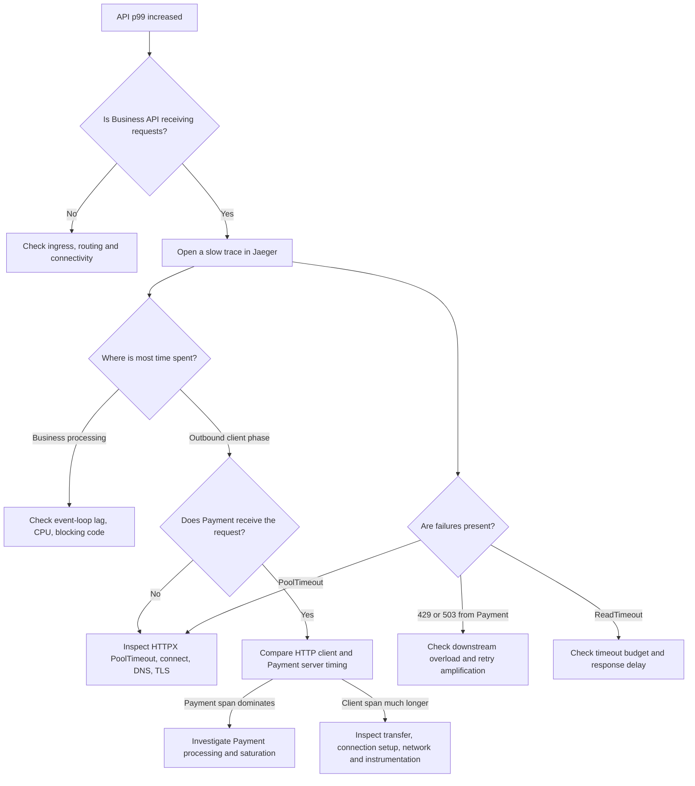

# Visual triage — Where is my API latency?

> **Module 001 only:** Client → Business FastAPI → Payment HTTP API. Database diagnosis belongs to Module 002. Values in examples are illustrative, not measured in the local lab.

## Incident decision tree

## How to use Jaeger (learning exercise)

1. Run [Lab 001](../001-downstream-api-latency/README.md), send a POST to `/orders`, then open http://localhost:16686.
2. Select `business-api` and **Find Traces**. Open a slow trace.
3. Expand `POST /orders`, the outbound HTTPX span (if present), and `POST /charge`.
4. Compare **start/end timestamps and durations**. A synchronous parent generally encloses its child; never add overlapping spans to calculate total time.
5. If Payment has no span, check whether the request reached it; a `PoolTimeout` can happen entirely within Business API.
6. Inspect span status and error attributes. Check logs for exact exception class and HTTP status.
7. Form one hypothesis and rerun with a controlled change.

## Triage matrix

| Evidence | Likely area | Next check | Avoid |
|---|---|---|---|
| Business span long; Payment span short | Business API | Event-loop lag, CPU, synchronous blocking, serialization | Blaming Payment |
| Payment server span long | Payment API | Processing duration, CPU, request concurrency | Blindly raising caller timeouts |
| HTTPX PoolTimeout; no Payment request | Caller connection pool | Pool utilization, in-flight requests, pool timeout | Assuming Payment returned 503 |
| HTTPX ConnectTimeout | Connect/network path | DNS, TCP, TLS, network reachability | Treating it as slow SQL |
| HTTPX ReadTimeout | Waiting for response | Payment server duration, response transfer, timeout budget | Unbounded retries |
| HTTPX span long; Payment server short | Client/network/transfer | Connection setup, payload size, instrumentation coverage | Assuming the span isolates pool wait |
| Payment returns 429/503 | Downstream rejection | Retry rate, overload, capacity | Retry storm |
| p99 high, p50 stable | Tail issue | Compare slow vs fast traces, queueing, concurrency | Optimizing only averages |

## Three self-guided scenarios

### A — Slow Payment
Business request: 3200 ms; Payment server: 2400 ms. **Question:** which service to investigate first? Answer: Payment processing and saturation, while accounting for the remaining caller/network time.

### B — Caller pool exhaustion
10 concurrent orders; Business HTTPX pool has 2 connections, pool timeout 50 ms, Payment delay 1 second. Many orders fail with Business 503 and **no matching Payment span**. **Question:** is Payment returning 503? Answer: no; Business maps its local PoolTimeout to HTTP 503.

### C — Blocking Business code
Business span: 2800 ms; Payment span: 100 ms. **Question:** what next? Answer: profile Business event-loop lag, blocking synchronous calls, CPU, and local processing.

## Before / after evidence worksheet

| Check | Before | After |
|---|---|---|
| Business API p50/p95/p99 | | |
| Payment server p50/p95/p99 | | |
| Caller PoolTimeout count | | |
| Downstream 429/503 count | | |
| Request concurrency | | |
| HTTPX pool size and pool timeout | | |
| Hypothesis supported by trace/logs? | | |

**Staff-level lesson:** tracing narrows the search space; logs, metrics, controlled experiments, and code inspection establish the cause. A missing span is an observability gap, not proof that no work occurred.
