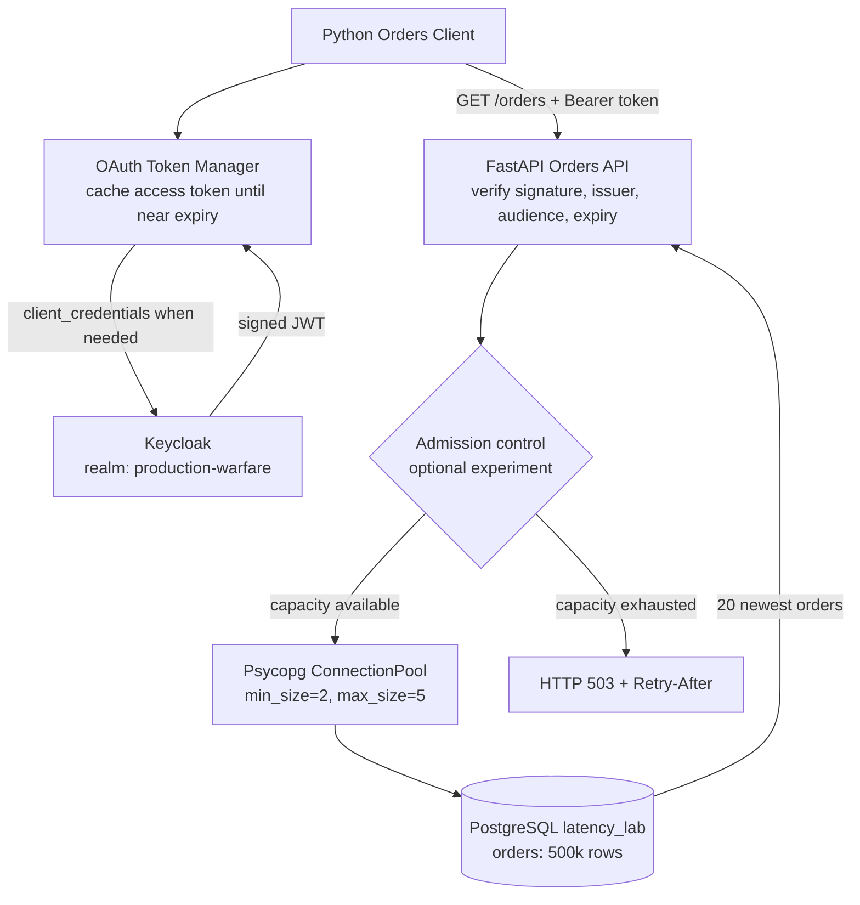

# Lab 002 — PostgreSQL Latency Warfare

> **Build → Break → Measure → Diagnose → Fix → Verify.**
>
> An API can be slow even when PostgreSQL executes the SQL in less than a millisecond. This lab teaches how to find the *actual* bottleneck, and what to do when a healthy database is overwhelmed by callers.

## Run the entire lab yourself (Docker Compose)

The repository now includes a **standalone learning implementation** of the same architecture. It is not a byte-for-byte copy of the original local WSL/kind source. The benchmark figures above are from our earlier hands-on session, **not** results of this newly packaged implementation.

**Requirements:** Docker Desktop with Compose, Python 3.10+ for the host load generator, and free ports **8000**, **8080**, **55433**. Demo credentials in the checked-in realm and Compose file are intentionally insecure: **local practice only**, never expose this stack to a public network or reuse these secrets.

```powershell
git clone https://github.com/bapuoldtown/production-engineering-warfare.git
cd production-engineering-warfare/labs/002-postgresql-latency
docker compose up -d --build
docker compose ps
```

On first startup PostgreSQL seeds **500,000 orders**. Keycloak imports the `production-warfare` realm, confidential `orders-api` client, service account, and audience mapper automatically. Keycloak may take a little time to start. If it is not ready, retry the token request below.

### 1. Obtain a real machine-to-machine token

In PowerShell:

```powershell
$tokenResponse = Invoke-RestMethod -Method Post -Uri "http://localhost:8080/realms/production-warfare/protocol/openid-connect/token" -ContentType "application/x-www-form-urlencoded" -Body @{grant_type="client_credentials";client_id="orders-api";client_secret="lab_client_secret_only"}
$token = $tokenResponse.access_token
Invoke-RestMethod -Uri "http://localhost:8000/orders?customer_id=420&mode=unpooled" -Headers @{Authorization="Bearer $token"}
```

Expected: JSON with 20 orders and measured connection/query timings. Try calling `/orders` **without** a bearer token: expected HTTP **401**. The FastAPI server checks JWT signature, issuer, audience and expiry using Keycloak's JWKS. The load generator obtains its own token; no manual copy/paste required.

### 2. Find the SQL bottleneck before adding an index

```powershell
docker compose exec postgres psql -U lab -d latency_lab -c "EXPLAIN (ANALYZE, BUFFERS) SELECT id, customer_id, created_at FROM orders WHERE customer_id=420 ORDER BY created_at DESC LIMIT 20;"
```

Observe the plan. Now add the composite index:

```powershell
Get-Content sql/create_index.sql | docker compose exec -T postgres psql -U lab -d latency_lab
docker compose exec postgres psql -U lab -d latency_lab -c "EXPLAIN (ANALYZE, BUFFERS) SELECT id, customer_id, created_at FROM orders WHERE customer_id=420 ORDER BY created_at DESC LIMIT 20;"
```

Compare plan and execution time; your measurements will differ from our original ~25 ms versus ~0.14 ms result.

### 3. Compare fresh connections against connection pooling

Use the token from step 1:

```powershell
Invoke-RestMethod -Uri "http://localhost:8000/orders?mode=unpooled" -Headers @{Authorization="Bearer $token"} | Select-Object -ExpandProperty timing_ms
Invoke-RestMethod -Uri "http://localhost:8000/orders?mode=pooled" -Headers @{Authorization="Bearer $token"} | Select-Object -ExpandProperty timing_ms
```

Repeat several times. The pooled mode reuses a **2–5 connection** Psycopg pool; unpooled opens a new connection per request. Both use the same indexed SQL query.

### 4. Deliberately exhaust the pool with concurrent traffic

Install the standalone host client dependency:

```powershell
python -m pip install httpx
python client/load_test.py
```

Defaults: **200 requests**, **200 concurrent callers**, **500 ms hold** of each acquired connection, `mode=pooled`. The load script requests a Keycloak access token automatically and reports response counts plus p50/p95/p99 across all responses and successful-only p95.

The API returns **503 + Retry-After: 2** for pool checkout timeouts rather than accidental 500 errors. This demonstrates controlled overload **not** increased capacity. Results depend on host CPU, Docker resources and client scheduling.

For a baseline without fault injection:

```powershell
$env:HOLD_MS="0"
python client/load_test.py
Remove-Item Env:HOLD_MS
```

For fresh-connection comparison:

```powershell
$env:MODE="unpooled"
$env:REQUESTS="20"
$env:CONCURRENCY="5"
$env:HOLD_MS="0"
python client/load_test.py
Remove-Item Env:MODE,Env:REQUESTS,Env:CONCURRENCY,Env:HOLD_MS
```

Do **not** run 200 simultaneous unpooled connections against a real database.

### 5. Inspect, troubleshoot and clean up

```powershell
docker compose logs -f api
docker compose logs --tail=100 keycloak
docker compose exec postgres psql -U lab -d latency_lab -c "SELECT count(*) FROM orders;"
docker compose down
```

`docker compose down` preserves the PostgreSQL volume. For a full reset of **this lab only**, `docker compose down -v` deletes its database volume, then `docker compose up -d --build` reseeds it.

**Challenge for readers:** implement a nonblocking admission-control semaphore ahead of pool acquisition, then rerun the exact same load test and compare successful-request p95, rejection rate and resource usage. We have **not** benchmarked that enhancement.

---

## The production incident

A FastAPI `GET /orders` endpoint queries 500,000 PostgreSQL order records by customer ID, returning the newest 20. The endpoint uses Keycloak OAuth2 client credentials for machine-to-machine authentication. At first, every request establishes a new PostgreSQL connection. Later, 200 simultaneous callers compete for a pool of just five connections.

**Questions we investigated:**
1. Is the SQL slow because of a missing index?
2. Why can API database time remain high after indexing?
3. What does connection pooling actually improve?
4. What happens when incoming demand exceeds pool capacity?
5. When should a service reject, queue, or slow incoming work?

## Architecture



**Lab topology:** Windows PowerShell, Python + `uv`, FastAPI, local Keycloak port-forward on `localhost:8080`, PostgreSQL Docker container `pg` on `localhost:5432`. The Kubernetes namespace is `db-latency-lab`. No cloud resources required.

## SQL and indexing

The query:

```sql
SELECT id, customer_id, created_at
FROM orders
WHERE customer_id = 420
ORDER BY created_at DESC
LIMIT 20;
```

The useful composite index:

```sql
CREATE INDEX CONCURRENTLY IF NOT EXISTS
  idx_orders_customer_created
ON orders (customer_id, created_at DESC);
```

Check the plan, not just the elapsed time:

```powershell
docker exec pg psql -U postgres -d latency_lab -c "EXPLAIN (ANALYZE, BUFFERS) SELECT id, customer_id, created_at FROM orders WHERE customer_id=420 ORDER BY created_at DESC LIMIT 20;"
```

**Observed in an earlier lab run:** approximately 25.252 ms before the composite index and 0.140 ms afterward for the indexed query benchmark (~180×). These were earlier measurements, not the same metric as HTTP request latency.

**Why `CONCURRENTLY`?** It allows ordinary reads and writes during index construction, but costs additional work and cannot run inside an explicit transaction block. `IF NOT EXISTS` checks the index *name*, not index equivalence. Our later attempt printed `relation "idx_orders_customer_created" already exists, skipping`: **do not add duplicate indexes**.

## Authentication: no manual token copying

The client requests a short-lived access token from Keycloak's token endpoint using `client_credentials`, caches it until shortly before expiry, and attaches `Authorization: Bearer <token>` to API requests. FastAPI validates JWT signature against JWKS, issuer, audience (`orders-api`), and expiration. When the cached token is near expiry, the client requests a *new* access token. This flow ordinarily does not use refresh tokens.

**Why this design?** Token caching avoids an extra Keycloak call per API request. Keep the token manager on the *calling* side and verification on the *receiving* side. Never commit OAuth client secrets, access tokens, database credentials, or local environment files. Use secret management and scoped database roles in production.

## Break and fix: fresh connections on every request

The initial endpoint did this on every request:

```python
conn = psycopg.connect(os.environ["DATABASE_URL"])
```

Instrument three boundaries with `time.perf_counter()`: acquire/connect, `cursor.execute()`, and `cursor.fetchall()`.

**Actual unpooled measurements (8 requests):**

| Request | Connection ms | Execute ms | Fetch ms | Total DB ms |
|---:|---:|---:|---:|---:|
| 1 | 15.57 | 9.86 | 0.05 | 25.49 |
| 2 | 32.37 | 2.18 | 0.03 | 34.59 |
| 3 | 28.39 | 2.69 | 0.03 | 31.10 |
| 4 | 11.08 | 1.94 | 0.03 | 13.05 |
| 5 | 11.50 | 1.89 | 0.03 | 13.42 |
| 6 | 11.84 | 1.94 | 0.03 | 13.80 |
| 7 | 23.34 | 2.22 | 0.03 | 25.59 |
| 8 | 12.00 | 1.81 | 0.03 | 13.84 |

**Diagnosis:** repeated connection establishment dominated these operations. The `fetchall()` step was negligible. With a standard Psycopg client-side cursor, `execute()` can already include transferring rows to client buffers, so these timings are **not** a perfect server/network decomposition.

### Fix: bounded connection reuse

Install:

```powershell
uv add psycopg-pool
```

Use a pool managed by FastAPI lifespan:

```python
from contextlib import asynccontextmanager
from fastapi import FastAPI, Request
from psycopg_pool import ConnectionPool
import os

@asynccontextmanager
async def lifespan(app):
    with ConnectionPool(
        conninfo=os.environ["DATABASE_URL"],
        min_size=2,
        max_size=5,
        timeout=2.0,
        open=False,
    ) as pool:
        pool.wait(timeout=10)
        app.state.db_pool = pool
        yield

app = FastAPI(lifespan=lifespan)

# In the existing /orders handler:
# pool = request.app.state.db_pool
# conn = pool.getconn()
# try:
#     ... execute and fetch ...
# finally:
#     pool.putconn(conn)
```

Use `pool.putconn(conn)` rather than `conn.close()` when checking out with `getconn()`.

**Actual pooled measurements:**

| Request | Pool acquisition ms | Execute ms | Fetch ms | Total DB ms |
|---:|---:|---:|---:|---:|
| 1 | 0.03 | 11.65 | 0.03 | 11.71 |
| 2 | 0.03 | 3.94 | 0.05 | 4.02 |
| 3 | 0.02 | 1.36 | 0.03 | 1.41 |
| 4 | 0.01 | 1.43 | 0.03 | 1.47 |
| 5 | 0.01 | 1.25 | 0.03 | 1.29 |

**Result:** connection acquisition fell from 11–32 ms to 0.01–0.03 ms in this local run. Warm database-operation time reached ~1.3–1.5 ms. This is **database-operation time**, not full HTTP latency, and local scheduling and warm-up matter.

## Break again: pool exhaustion

**Fault injection, lab only:** hold a checked-out connection for 500 ms using `time.sleep(0.5)`; set pool `max_size=5`, acquisition `timeout=2.0`; launch 200 concurrent requests.

Run from the existing `app/` directory (after configuring the client OAuth environment variables):

```powershell
uv run python client/load_test.py
```

### Observed outcomes

| Metric | Before explicit pool timeout handling | After mapping `PoolTimeout` to 503 |
|---|---:|---:|
| Total requests | 200 | 200 |
| HTTP 200 | 113 | 110 |
| HTTP 500 | 87 | 0 |
| HTTP 503 | 0 | 90 |
| p50 across **all** responses | 6970.13 ms | 6822.11 ms |
| p95 across **all** responses | 11313.62 ms | 11336.17 ms |
| p99 across **all** responses | 12260.68 ms | 11817.64 ms |

The two runs are independent and subject to scheduling variation. The first run's 500 responses were consistent with pool timeouts; the second run verified that the timeout-handling change produced 503s. These figures do **not** demonstrate improved capacity or successful-request p99.

Handle expected pool acquisition failures explicitly:

```python
from fastapi import HTTPException
from psycopg_pool import PoolTimeout

try:
    conn = pool.getconn()
except PoolTimeout:
    raise HTTPException(
        status_code=503,
        detail="Database connection pool exhausted",
        headers={"Retry-After": "2"},
    )
```

Release every successfully acquired connection in `finally`. A 503 is a controlled failure response, **not a capacity fix**.

## When to use each pattern — real-world scenarios

| Pattern | Triggering scenario | What it solves | Tradeoff / warning |
|---|---|---|---|
| Composite index | Orders by customer, newest first; large table; sequential scan and sort | Efficient filter + ordering | Write overhead, storage, index maintenance; inspect plan first |
| Connection pool | High-QPS FastAPI repeatedly opens DB sessions | Reuses expensive connections | Pool exhaustion, queue wait, total DB connection budget |
| Fail-fast admission control | Payment API has five DB slots and 100 more requests arrive | Rejects excess promptly, protects resources | More 503s; clients need safe retries, idempotency |
| Bounded queue | Short bursts to an inventory service | Absorbs brief spikes without unlimited waiting | Queue wait increases tail latency; bound size and age |
| Kafka consumer pause/resume | Consumer writes to a slow PostgreSQL database | Stops adding work while downstream catches up | Consumer lag rises; preserve polling/rebalance behavior |
| LLM inference concurrency cap | Agent gateway sends too many requests to a constrained model endpoint | Protects latency and inference capacity | Queue or reject requests; enforce budgets |
| HTTP rate limiting | Client exceeds contracted requests/minute | Controls traffic rate and fairness | Rate alone does not cap concurrent in-flight work |
| Circuit breaker | Remote dependency repeatedly fails | Avoids repeated calls to unhealthy dependency | Must handle recovery/half-open probes |

**Backpressure vs rate limiting:** rate limiting constrains *arrival rate* (e.g., 1,000/minute); concurrency control constrains *in-flight work* (e.g., five DB operations). Backpressure is the broader response to downstream saturation: bounded queueing, producer slowdown, or rejection.

**Payments nuance:** retries must use idempotency keys, exponential backoff with jitter, and a retry budget; otherwise retries can duplicate side effects or amplify overload. Use HTTP 429 for applicable rate-limit policies, and 503 for temporary service capacity exhaustion.

### Admission control: a proposed next experiment, not a measured result

A `threading.BoundedSemaphore(5)` acquired non-blockingly before pool checkout can fail fast when all five slots are busy. Release it in `finally`. **We did not run and benchmark this change**, so no improvement is claimed. A per-process semaphore is not a global limit: with multiple Uvicorn workers or Kubernetes replicas, each process has its own gate and pool. Sync FastAPI handlers can also queue in the application's thread pool before reaching the gate. Budget total connections across replicas.

## Production checklist

- [ ] Verify the SQL plan and index selectivity; avoid duplicate indexes.
- [ ] Instrument connection acquisition, query execution, and request duration separately.
- [ ] Use bounded pools, acquisition timeouts, and pool wait/usage metrics.
- [ ] Return intentional retryable overload errors, not accidental 500s.
- [ ] Measure HTTP 200 latency separately from HTTP 503 latency and failure rate.
- [ ] Add bounded admission control or queues based on the workload.
- [ ] Use idempotency and bounded retries with backoff and jitter.
- [ ] Budget database connections across all processes and replicas.
- [ ] Remove artificial 500 ms delay after fault injection.
- [ ] Keep credentials out of Git; use workload identity or managed secrets where appropriate.

## Interview story

> Our indexed PostgreSQL query was fast, but the FastAPI database operation still took tens of milliseconds. We instrumented connection, execution and fetch separately, and found that fresh connection setup took 11–32 ms. A bounded Psycopg pool reduced acquisition to 0.01–0.03 ms, with warm database operations near 1.3–1.5 ms. We then deliberately saturated five connections with 200 concurrent requests. Mapping pool acquisition timeouts to HTTP 503 made overload explicit, but did not increase capacity. The next design consideration is bounded admission control, safe retries, and cross-replica connection budgeting.

## Reproduction notes

Run only against the local lab, not production. Required existing components: Docker PostgreSQL `pg` with `latency_lab.orders`, Keycloak realm `production-warfare` with service client `orders-api`, and the FastAPI/client scripts built in this chapter. The repository note captures the observed measurements and code patterns; it does not claim the entire environment can be recreated from this Markdown alone.

**A good engineer doesn't just make the graph green. They leave enough evidence for the next engineer to understand why.** ❤️
